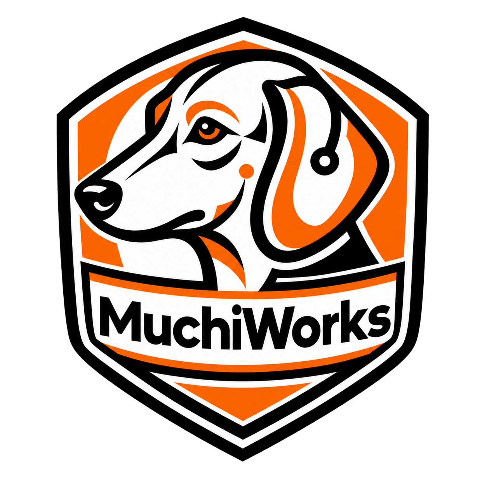

  

  

  <strong>Human-centered digital products that do their job and get out of the way.</strong>

  <a href="https://muchiworks.com">Website</a> ·
  <a href="https://muchiworks.com/products">Products</a> ·
  <a href="https://muchiworks.com/contact">Contact</a>

## About MuchiWorks

MuchiWorks is a product studio building clear, useful software around real needs.
We do not design products around artificial loops whose only purpose is to keep
people on a screen. A product should be useful when it is needed and leave room
for people to continue with their lives when its job is done.

## Products

<table>
  <tr>
    <td width="92" align="center">
      
    </td>
    <td>
  <strong><a href="https://muchiworks.com/products/muchilife">MuchiLife</a></strong> 
  An Android product for choosing a Focus duration, keeping selected apps
  closed during that time, and protecting the boundary the person set.  
  <a href="https://github.com/MuchiWorks/muchilife-showcase">
    <strong>View the public product and engineering case study</strong>
  </a>
</td>
  </tr>
</table>

## Our approach

- **Useful by design:** each product must answer a real need.
- **Respect for people:** time, decisions, privacy, and informed choice matter.
- **Built to finish:** the product completes its task without asking for more
  attention than the task requires.
- **Operationally responsible:** identity, payments, data, recovery, and deletion
  are treated as product responsibilities rather than afterthoughts.

## Engineering areas

Mobile product engineering · Android integrations · Firebase and Google Cloud ·
Google Play Billing · Identity and account lifecycle · Secure backend operations ·
Localization · Testing, monitoring, and release engineering

## Public work

Our production source code is private. Public repositories provide product case
studies, engineering context, selected reusable work, and documentation without
exposing credentials, customer data, or security-sensitive implementation details.

## Contact

- Product support: [help@muchiworks.com](mailto:help@muchiworks.com)
- Developer contact: [developer@muchiworks.com](mailto:developer@muchiworks.com)
- Website: [muchiworks.com](https://muchiworks.com)
